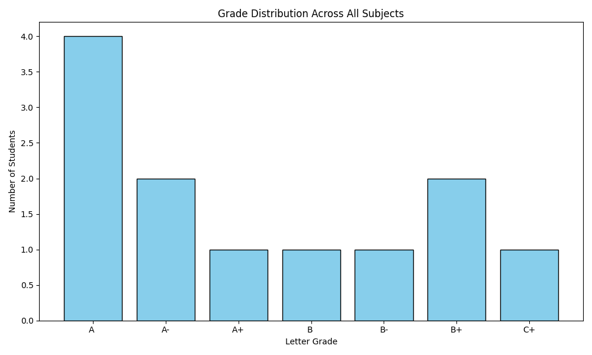
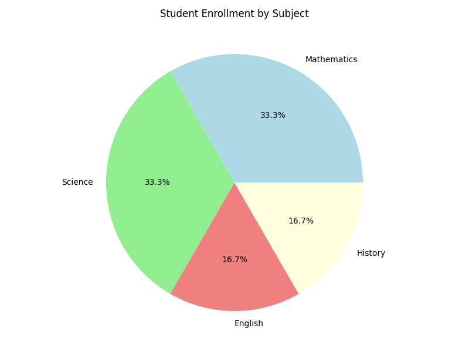
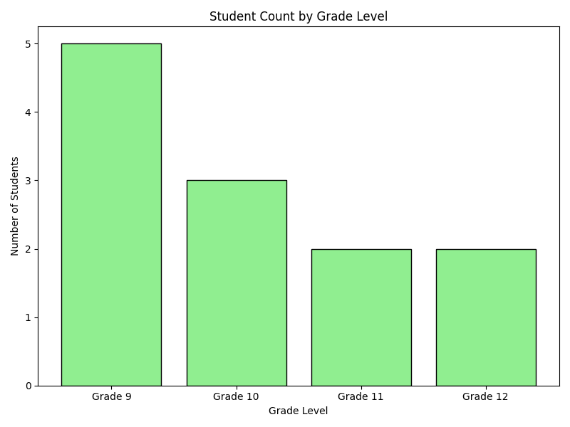

# Sunrise High School SIS

**Python & PostgreSQL Student Information System**


## 1. Project Overview


Sunrise High School Student Information System (SIS) is a Python-based application designed to support student record management, academic performance tracking, attendance monitoring, and educational reporting.


The project demonstrates how relational databases, secure authentication, and data analytics can be integrated into an information system to support school administration and data-informed decision-making.


The application currently operates as a local, command-line prototype using fictional student records. Cloud deployment is a future development objective.


## 2. Features


### User Authentication

- Username and password authentication.

- Password verification using bcrypt hashing.

- User roles stored in PostgreSQL.

- Login activity logging.


### Student Management

- View student records.

- Filter students by grade level (Grades 9–12).

- Add new student records.

- Store academic subjects and letter grades.

- Validate selected user inputs.


### Attendance Management

- Record student attendance.

- Supported statuses: Present, Absent, and Late.

- Store attendance dates and the username responsible for recording attendance.

- Generate attendance summaries.


### Academic Analytics

- Calculate total student records.

- Analyze academic grade distributions.

- Summarize subject assignments.

- Display student counts by grade level.


### Reporting and Visualization

- Generate text-based student performance reports.

- Produce academic visualizations using Matplotlib.

- Save charts as PNG images.


## 3. System Architecture


The application follows a database-backed Python architecture.


**Application workflow:**


```text

School Administrator

        |

        v

Python Command-Line Interface

        |

        v

Application Logic

(Authentication, Student Management,

Attendance, Analytics, Reporting)

        |

        v

psycopg2 Database Connection

        |

        v

PostgreSQL Database

(Students, Attendance, Users, Audit Log)

        |

        v

Reports and Matplotlib Visualizations

```


The application uses Python to process user requests and PostgreSQL to store and retrieve records.


Database credentials are loaded from environment variables rather than embedded directly in the current database connection source code.


## 4. Technology Stack


| Technology | Purpose |

|---|---|

| Python | Application development |

| PostgreSQL | Relational database |

| psycopg2 | Python–PostgreSQL connectivity |

| bcrypt | Password hashing and verification |

| python-dotenv | Environment variable configuration |

| Matplotlib | Academic data visualization |

| Git and GitHub | Version control and project documentation |


## 5. Installation and Setup


### Prerequisites


Install:


- Python

- PostgreSQL

- Git

- Required Python packages


### Install Python Dependencies


From the project directory, install the required packages:


```bash

python -m pip install psycopg2-binary bcrypt python-dotenv matplotlib

```


### Database Configuration


Create a PostgreSQL database named:


```text

highschool_sis_db

```


Create a local `.env` file in the project directory:


```env

DB_PASSWORD=your_local_postgresql_password

```


The current database connection configuration expects PostgreSQL on `127.0.0.1`, port `5432`, using the `postgres` database user.


**Security note:** Do not commit `.env` files, database passwords, or other credentials to GitHub.


Database initialization and account provisioning should be reviewed before using the application in a new environment.


## 6. Running the Application


From the project directory, execute:


```bash

python main.py

```


The application prompts for a username and password.


After successful authentication, the main menu provides the following options:


1\. View all students

2\. Filter students by grade level

3\. Add a new student

4\. Take attendance

5\. View attendance summary

6\. View analytics and visualizations

7\. Generate performance report

8\. Exit


Use option 8 to exit the application.


## 7. Functional Testing and Validation


The application was tested locally in November 2026 using fictional student records.


| Test | Observed Result |

|---|---|

| PostgreSQL database connection | Successful |

| Principal account authentication | Successful |

| Student record retrieval | Successful |

| Grade-level filtering | Successful |

| Invalid grade input handling | Rejected nonnumeric input |

| New student registration | Successful |

| Attendance recording | Successful |

| Attendance summary | Matched stored attendance records |

| Academic analytics | Generated grade and subject counts |

| Performance report generation | Text report created |

| Grade distribution visualization | Chart generated |

| Subject enrollment visualization | Chart generated |

| Student count by grade level | Chart generated |

| Application exit | Successful |


The demonstration dataset contained 12 student records after testing.


These results establish that the listed functions operated successfully during the observed local tests. They do not constitute comprehensive automated testing, security certification, or production-readiness validation.


## 8. Project Evidence

The following visualizations and performance report were generated
using fictional student data during local application testing.

### Grade Distribution



### Student Enrollment by Subject



### Student Count by Grade Level



### Student Performance Report

[View Student Performance Report](docs/evidence/highschool_performance_report.txt)

All student records used in these demonstration outputs are fictional or simulated.

## 9. Security Considerations


The prototype implements several security-related mechanisms:


- bcrypt password hashing.

- Parameterized SQL operations in the tested authentication and password-reset workflows.

- PostgreSQL foreign-key and attendance-status constraints.

- Environment-based database password configuration.

- An audit log table for recording application activity.


### Current Limitations


The application is a development prototype and should not be considered production-ready.


Areas requiring additional work include:


- Secure password entry at the login prompt.

- Administrator authentication and authorization for password resets.

- Verification and enforcement of role-based permissions.

- Comprehensive audit-log coverage.

- Secure database account permissions.

- Automated security and regression testing.

- Review of historical credentials exposed in Git history.


No real student information should be entered into the prototype without appropriate privacy and security safeguards.


## 10. Future Improvements


Planned enhancements include:


- Web-based administrative dashboard.

- Secure role-based access control.

- Student enrollment and course management enhancements.

- Automated testing and CI/CD workflows.

- Cloud deployment using AWS or Microsoft Azure.

- Improved reporting and interactive analytics.

- Backup, recovery, monitoring, and production security controls.

- Expanded support for academic and administrative workflows.


## Author


**Kehinde Oluwaseye Onifade**


MS Information Systems  

Saint Louis University


**Project Focus:** Information Systems, Educational Technology, Relational Databases, Data Analytics, and Cloud-Ready Application Development.


---


*Sunrise High School SIS is an educational software prototype developed for learning, technical demonstration, and portfolio documentation.*


